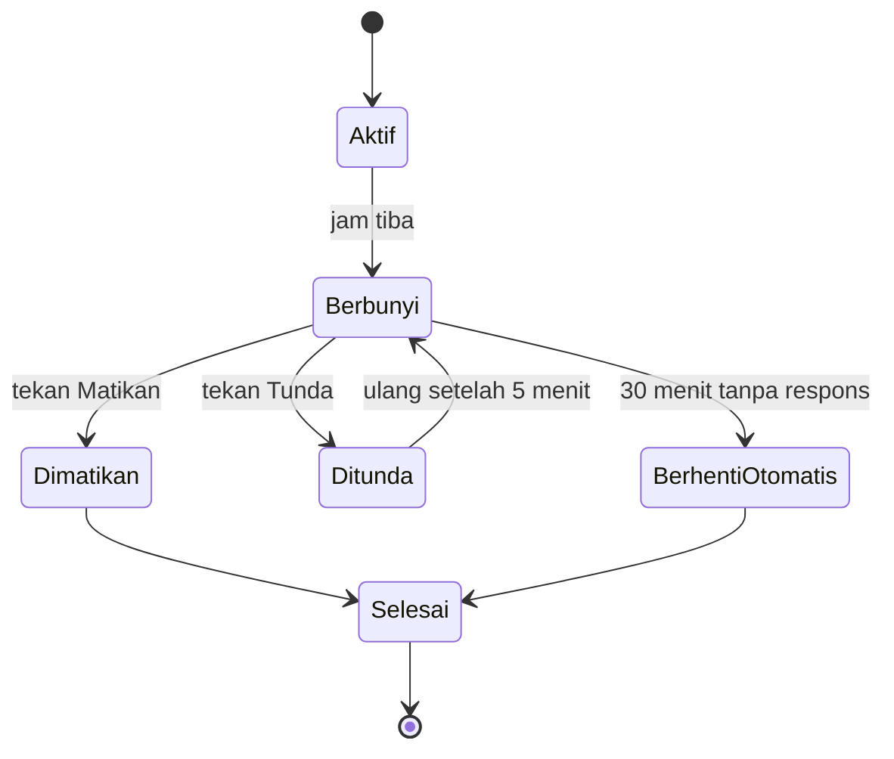

# PRD Aplikasi Alarm Web

Tanggal: 2026-10-28

## 1. Ringkasan Produk

Aplikasi alarm web yang berjalan sepenuhnya di browser: pengguna membuat banyak alarm, memilih file MP3 sendiri sebagai nada, dan alarm berhenti otomatis setelah 30 menit bila tidak dimatikan.

**Masalah yang diselesaikan:** alarm bawaan perangkat sering terbatas pada nada preset dan sulit dipakai dari browser. Aplikasi ini memberi kontrol penuh atas nada dan jadwal tanpa akun, server, atau instalasi.

| Lapisan | Teknologi | Peran |
| --- | --- | --- |
| Struktur | HTML5 | Halaman, form alarm, elemen `<audio>` |
| Tampilan | CSS3 | Layout responsif, tema terang/gelap |
| Logika | JavaScript (ES modules, tanpa framework) | Penjadwalan, kontrol audio, UI |
| Penyimpanan | IndexedDB | Menyimpan alarm dan file MP3 (Blob) secara lokal |
| Opsional | Service Worker, Notification API | Notifikasi dan penggunaan offline |

## 2. Tujuan dan Non-Tujuan

**Tujuan versi 1.0**

- Pengguna dapat membuat, mengubah, mengaktifkan/menonaktifkan, dan menghapus banyak alarm.
- Setiap alarm memakai file MP3 pilihan pengguna, tersimpan permanen di perangkat.
- Alarm berbunyi tepat waktu dan berhenti otomatis setelah 30 menit jika tidak dimatikan.
- Data tetap ada setelah browser ditutup atau halaman dimuat ulang.

**Non-tujuan (di luar cakupan 1.0)**

- Sinkronisasi antar perangkat dan akun pengguna.
- Alarm yang berbunyi saat browser tertutup sepenuhnya atau perangkat mati.
- Aplikasi native iOS/Android, dan integrasi kalender.
- Pengeditan atau pemotongan audio di dalam aplikasi.

## 3. Target Pengguna dan User Stories

Pengguna utama adalah orang yang ingin bangun atau diingatkan dengan nada pribadi (musik, murotal, rekaman suara) dan memakai laptop atau ponsel dengan browser modern yang tetap terbuka.

| ID | Sebagai pengguna, saya ingin… | Agar… | Prioritas |
| --- | --- | --- | --- |
| US-01 | menambah beberapa alarm dengan jam dan hari berulang | bisa punya alarm pagi, siang, dan malam | Wajib |
| US-02 | mengunggah file MP3 untuk tiap alarm | nada sesuai selera saya | Wajib |
| US-03 | alarm berhenti sendiri setelah 30 menit | suara tidak berbunyi terus bila saya tidak di tempat | Wajib |
| US-04 | mematikan alarm yang berbunyi dengan satu tombol | cepat berhenti saat terbangun | Wajib |
| US-05 | mengaktifkan atau menonaktifkan alarm tanpa menghapusnya | bisa dipakai lagi nanti | Wajib |
| US-06 | mengubah atau menghapus alarm | jadwal selalu terkini | Wajib |
| US-07 | menunda (snooze) alarm beberapa menit | bisa tidur sebentar lagi | Sebaiknya ada |
| US-08 | mencoba dengar nada sebelum menyimpan | tahu nada yang dipilih benar | Sebaiknya ada |
| US-09 | alarm yang terlewat saat browser tertutup ditandai | tahu ada alarm yang tidak berbunyi | Sebaiknya ada |

## 4. Kebutuhan Fungsional

| ID | Kebutuhan | Rincian |
| --- | --- | --- |
| FR-01 | Daftar alarm | Menampilkan semua alarm urut berdasarkan jam; tiap item menunjukkan jam, label, hari berulang, nama file MP3, dan saklar aktif/nonaktif. |
| FR-02 | Tambah alarm | Form berisi jam (HH:MM), label opsional, hari berulang (Sen–Min atau sekali saja), dan pilihan file MP3. |
| FR-03 | Ubah dan hapus | Alarm dapat diedit atau dihapus; penghapusan meminta konfirmasi. Menghapus alarm juga menghapus MP3 miliknya bila tidak dipakai alarm lain. |
| FR-04 | Unggah MP3 | Menerima file `audio/mpeg` (.mp3), maksimal 10 MB per file. File di luar aturan ditolak dengan pesan jelas. File disimpan sebagai Blob di IndexedDB. |
| FR-05 | Pratinjau nada | Tombol putar/berhenti untuk mendengar MP3 sebelum alarm disimpan. |
| FR-06 | Alarm berbunyi | Saat jam sistem sama dengan jam alarm aktif, MP3 diputar berulang (loop) dan layar alarm muncul dengan label, jam, dan tombol Matikan serta Tunda. |
| FR-07 | Auto-stop 30 menit | Begitu alarm mulai berbunyi, timer 30 menit berjalan. Jika pengguna belum mematikan, audio dihentikan otomatis dan status alarm dicatat sebagai "berhenti otomatis". |
| FR-08 | Matikan manual | Tombol Matikan menghentikan audio seketika dan membatalkan timer 30 menit. |
| FR-09 | Tunda (snooze) | Tombol Tunda menghentikan audio dan membunyikan ulang setelah 5 menit (bisa diatur). Setiap bunyi baru memulai timer 30 menit dari awal. |
| FR-10 | Pengulangan | Alarm sekali pakai otomatis nonaktif setelah berbunyi; alarm mingguan tetap aktif untuk hari berikutnya. |
| FR-11 | Alarm bersamaan | Jika beberapa alarm jatuh pada menit yang sama, semua ditampilkan di layar alarm; hanya satu audio diputar pada satu waktu, sisanya antre. |
| FR-12 | Persistensi | Semua alarm, MP3, dan pengaturan dimuat dari IndexedDB saat aplikasi dibuka. |
| FR-13 | Alarm terlewat | Saat aplikasi dibuka, alarm yang seharusnya berbunyi saat aplikasi tertutup ditampilkan sebagai "terlewat", tidak dibunyikan terlambat. |
| FR-14 | Notifikasi | Meminta izin Notification API agar peringatan muncul walau tab ada di latar belakang. |

**Aturan auto-stop 30 menit.** Batas dihitung dari saat audio mulai diputar, bukan dari jam alarm. Timer memakai selisih waktu (`Date.now()` dikurangi waktu mulai), bukan penghitung `setTimeout` tunggal, agar tetap akurat bila tab sempat ditangguhkan browser.

## 5. Kebutuhan Non-Fungsional

| Aspek | Target |
| --- | --- |
| Ketepatan waktu | Alarm berbunyi paling lambat 1 detik dari jam yang ditetapkan saat tab aktif. |
| Performa | Halaman siap dipakai di bawah 2 detik; daftar 100 alarm tetap lancar. |
| Penyimpanan | Semua data lokal di IndexedDB; tidak ada data dikirim ke server. |
| Kompatibilitas | Chrome, Edge, Firefox, dan Safari versi terbaru di desktop dan seluler. |
| Responsif | Nyaman dipakai pada lebar layar 360 px hingga desktop. |
| Aksesibilitas | Semua tombol dapat dijangkau keyboard, label ARIA, kontras warna WCAG AA. |
| Privasi | File MP3 tidak pernah meninggalkan perangkat; tidak ada pelacakan. |
| Keandalan | Kegagalan IndexedDB (mode privat, kuota penuh) ditangani dengan pesan jelas, bukan layar kosong. |

## 6. Desain Data IndexedDB

Database `alarm-app` (versi 1) memakai tiga object store. MP3 disimpan terpisah dari alarm agar daftar alarm dimuat cepat dan satu file bisa dipakai beberapa alarm.

**Store `alarms`** (keyPath `id`, autoIncrement)

| Field | Tipe | Keterangan |
| --- | --- | --- |
| id | number | Kunci utama |
| label | string | Nama alarm, boleh kosong |
| time | string | Format `HH:MM` (24 jam) |
| days | number[] | Hari berulang, 0 = Minggu … 6 = Sabtu; kosong = sekali saja |
| soundId | number | Rujukan ke store `sounds` |
| enabled | boolean | Alarm aktif atau tidak |
| snoozeMinutes | number | Lama tunda, default 5 |
| lastTriggeredAt | number | Timestamp bunyi terakhir (ms), mencegah bunyi ganda |
| createdAt | number | Timestamp pembuatan |

**Store `sounds`** (keyPath `id`, autoIncrement)

| Field | Tipe | Keterangan |
| --- | --- | --- |
| id | number | Kunci utama |
| name | string | Nama file asli |
| blob | Blob | Isi MP3 |
| size | number | Ukuran dalam byte |
| createdAt | number | Timestamp unggah |

**Store `history`** (keyPath `id`, autoIncrement): riwayat bunyi. Field: `alarmId`, `startedAt`, `endedAt`, `endReason` (`dismissed` | `snoozed` | `auto-stopped` | `missed`).

**Index:** `alarms.enabled` dan `alarms.time` untuk pencarian alarm aktif; `history.alarmId` untuk riwayat per alarm.

**Catatan teknis:** MP3 dibaca sebagai Blob lalu diputar lewat `URL.createObjectURL(blob)`. URL dilepas dengan `URL.revokeObjectURL` setelah alarm berhenti agar memori tidak bocor.

## 7. Arsitektur dan Logika Alarm

Aplikasi dibagi menjadi lima modul JavaScript dengan tugas terpisah (struktur file ada di bagian 11).

- `db.js`: satu-satunya modul yang menyentuh IndexedDB.
- `scheduler.js`: memeriksa jadwal tiap detik dan memberi tahu bila ada alarm jatuh tempo.
- `player.js`: memutar MP3 berulang, menjalankan timer auto-stop 30 menit, dan menghentikan audio.
- `ui.js`: menggambar daftar alarm, form, dan layar alarm berbunyi.
- `app.js`: menyambungkan semua modul saat halaman dibuka.

**Alur pemeriksaan jadwal (tiap detik)**

1. Ambil alarm dengan `enabled = true` dari memori; data dimuat sekali dari IndexedDB dan diperbarui saat ada perubahan.
2. Bandingkan jam:menit dan hari sekarang dengan `time` dan `days` tiap alarm.
3. Jika cocok dan `lastTriggeredAt` bukan menit ini, tandai alarm jatuh tempo dan simpan `lastTriggeredAt`.
4. Serahkan ke `player.js`: putar MP3 berulang, catat `startedAt`, mulai pemantauan auto-stop.
5. Selama berbunyi, hitung `Date.now() - startedAt` tiap detik; bila sudah 30 menit, hentikan audio dan catat `auto-stopped`.

**Siklus status alarm**



Alarm pindah dari Aktif ke Berbunyi saat jam tiba, lalu berakhir lewat salah satu dari tiga jalur; hanya Tunda yang kembali ke Berbunyi. Setelah Selesai, alarm sekali pakai menjadi nonaktif dan alarm mingguan tetap aktif.

## 8. Desain UI/UX

Aplikasi satu halaman dengan tiga tampilan.

**Layar utama (daftar alarm)**

- Jam digital besar dan tanggal hari ini di bagian atas.
- Daftar kartu alarm: jam besar, label, hari berulang, nama MP3, saklar aktif/nonaktif, tombol ubah dan hapus.
- Tombol mengambang "+ Alarm" di kanan bawah.
- Tampilan kosong yang mengajak menambah alarm pertama.

**Form alarm (dialog)**

- Input jam (`<input type="time">`), label, pilihan hari berupa tombol Sen–Min, lama tunda.
- Area pilih file MP3 (klik atau seret), menampilkan nama dan ukuran file, tombol pratinjau.
- Pesan galat di bawah field yang salah, tombol Simpan dan Batal.

**Layar alarm berbunyi (overlay penuh)**

- Jam, label alarm, dan hitung mundur "berhenti otomatis dalam MM:SS".
- Dua tombol besar: **Matikan** (utama) dan **Tunda 5 menit**.
- Judul tab dan favicon berkedip agar menarik perhatian saat tab di latar belakang.

**Prinsip desain:** tombol Matikan harus terbesar dan bisa ditekan dalam satu ketukan; tema terang dan gelap mengikuti pengaturan sistem; semua status penting (aktif, berbunyi, terlewat) dibedakan dengan teks, bukan warna saja.

## 9. Batasan Browser, Edge Case, dan Risiko

Alarm berbasis web hanya andal selama halaman aplikasi tetap terbuka. Batasan ini harus dikomunikasikan jelas kepada pengguna di dalam aplikasi.

| Risiko / edge case | Dampak | Mitigasi |
| --- | --- | --- |
| Kebijakan autoplay browser memblokir audio tanpa interaksi pengguna | Alarm berbunyi tanpa suara | Minta pengguna menekan tombol "Aktifkan alarm" saat pertama membuka aplikasi untuk membuka izin audio; tampilkan status "audio siap". |
| Tab di latar belakang membatasi timer (`setInterval` diperlambat) | Alarm terlambat beberapa detik hingga menit | Cek jadwal dengan membandingkan jam sistem tiap detik, bukan menghitung selisih; pakai Web Worker untuk timer; tampilkan peringatan jika tab tersembunyi. |
| Laptop tidur atau ponsel terkunci | Alarm tidak berbunyi | Tampilkan catatan batasan; saat dibuka kembali, tandai alarm terlewat (FR-13). |
| Browser dan perangkat tidak mendukung audio di layar terkunci | Auto-stop tidak berjalan | Auto-stop dihitung dari selisih waktu saat tab aktif kembali; jika sudah lewat 30 menit, audio langsung dihentikan. |
| Kuota IndexedDB penuh atau mode privat | Gagal menyimpan MP3 | Tangkap `QuotaExceededError`, tampilkan pesan, batasi 10 MB per file. |
| File bukan MP3 atau rusak | Audio tidak bisa diputar | Validasi tipe dan coba muat sebelum menyimpan; tolak jika `error` pada elemen audio. |
| Dua alarm di menit yang sama | Suara bertumpuk | Satu audio per waktu, alarm lain masuk antre (FR-11). |
| Perubahan zona waktu atau jam sistem | Alarm bunyi pada waktu salah | Hitung ulang jadwal setiap detik dari jam sistem, simpan `lastTriggeredAt` agar tidak bunyi ganda. |
| Beberapa tab aplikasi terbuka | Alarm berbunyi ganda | Kunci antar tab dengan `BroadcastChannel` atau Web Locks API; hanya satu tab yang membunyikan. |

## 10. Acceptance Criteria dan Metrik

**Acceptance criteria utama**

- [ ] Pengguna dapat menambah minimal 10 alarm, masing-masing dengan MP3 berbeda, dan semuanya tetap ada setelah halaman dimuat ulang.
- [ ] Alarm aktif berbunyi pada menit yang tepat, dengan MP3 yang dipilih, dan diputar berulang selama belum dimatikan.
- [ ] Jika alarm tidak dimatikan, audio berhenti sendiri 30 menit (±2 detik) setelah mulai berbunyi, dan riwayat mencatat `auto-stopped`.
- [ ] Menekan Matikan menghentikan audio dalam 1 detik dan membatalkan timer auto-stop.
- [ ] Snooze membunyikan ulang sesuai lama tunda, dan timer 30 menit dimulai lagi.
- [ ] Alarm sekali pakai menjadi nonaktif setelah berbunyi; alarm mingguan tetap aktif.
- [ ] Dua alarm di menit yang sama tidak memutar dua audio sekaligus.
- [ ] File non-MP3 atau lebih dari 10 MB ditolak dengan pesan galat.
- [ ] Aplikasi dapat dipakai penuh lewat keyboard dan lolos pemeriksaan kontras WCAG AA.

**Metrik keberhasilan**

| Metrik | Target |
| --- | --- |
| Ketepatan bunyi alarm (tab aktif) | ≥ 99% dalam toleransi 1 detik |
| Ketepatan auto-stop | 100% berhenti di 30 menit ±2 detik |
| Waktu menambah satu alarm lengkap dengan MP3 | di bawah 30 detik |
| Kegagalan simpan IndexedDB | di bawah 1% sesi |

## 11. Struktur Proyek dan Milestone

```
alarm-app/
├── index.html
├── css/
│   └── style.css
└── js/
    ├── app.js          // titik masuk, inisialisasi
    ├── db.js           // pembungkus IndexedDB (alarms, sounds, history)
    ├── scheduler.js    // pemeriksa jadwal tiap detik, deteksi alarm jatuh tempo
    ├── player.js       // kontrol audio, loop, timer auto-stop 30 menit
    └── ui.js           // render daftar, form, overlay alarm
```

Estimasi berikut perkiraan kasar untuk satu pengembang dan perlu disesuaikan.

| Fase | Isi | Estimasi |
| --- | --- | --- |
| 1. Fondasi | Struktur HTML/CSS, `db.js` dengan store `alarms`, `sounds`, `history` | 3 hari |
| 2. Kelola alarm | Form tambah/ubah/hapus, unggah dan validasi MP3, pratinjau | 4 hari |
| 3. Mesin alarm | `scheduler.js`, `player.js`, auto-stop 30 menit, matikan, snooze, antrean | 4 hari |
| 4. Ketahanan | Alarm terlewat, kunci antar tab, penanganan galat, notifikasi | 3 hari |
| 5. Poles dan uji | Responsif, aksesibilitas, uji lintas browser, perbaikan bug | 3 hari |
